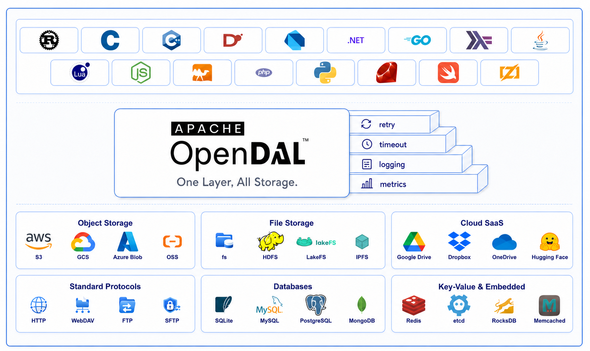

# Apache OpenDAL™: *One Layer, All Storage.*

[](https://github.com/apache/opendal/discussions)
[](https://opendal.apache.org/discord)
[](https://deepwiki.com/apache/opendal)

**Apache OpenDAL™** (`/ˈoʊ.pən.dæl/`, pronounced "OH-puhn-dal") is an Open Data Access Layer that keeps application storage code clean, from simple file reads and writes to streaming, byte-range reads, and concurrent uploads.

Use OpenDAL when your application talks to a single S3 bucket or local directory and you want one API for everyday operations, large transfers, and retries. Keep the same operator model when you test in memory, develop on local disk, or connect to [50+ storage services][Services Docs] from Rust, Python, Node.js, Java, Go, and more.

## Why OpenDAL

- **Clean code for a single backend**: read, write, stat, list, copy, and delete through one `Operator`. Paths, metadata, and error kinds follow one model across operations.
- **Built for demanding I/O**: stream large objects, read only the byte ranges you need, and upload parts concurrently on services with multipart or block writes. Add retries, timeouts, observability, and concurrency limits as layers.
- **Portable across environments and backends**: use `memory` in tests, `fs` in local development, and object storage, file systems, databases, or key-value services in production. Capability checks show where services differ.
- **Proven in data-intensive systems**: projects such as Dify, RAGFlow, LlamaIndex, Databend, RisingWave, GreptimeDB, and Lance build on OpenDAL. Read how [ScopeDB accesses object storage with OpenDAL][ScopeDB Case Study].

Bindings share the service model and follow their own language conventions, so available options and layers vary by binding. Each language guide lists what its binding supports.

## Quickstart

Each quickstart uses the in-memory service, so it runs without credentials. The second snippet in each language shows the same API against S3.

### Python

```shell
pip install opendal
```

```python
import opendal

op = opendal.Operator("memory")

op.write("hello.txt", b"Hello, World!")
print(op.read("hello.txt").decode())
print(f"size = {op.stat('hello.txt').content_length} bytes")
op.delete("hello.txt")
```

Point the operator at S3, add retries, and read only what you need:

```python
import opendal
from opendal.layers import RetryLayer

op = opendal.Operator("s3", bucket="my-bucket", region="us-east-1").layer(
    RetryLayer(max_times=3)
)

# Read only the first 64 KiB of an object.
header = op.read("data/events.parquet", offset=0, size=64 * 1024)

# Stream a large object instead of loading it into memory.
total = 0
with op.open("data/events.parquet", "rb") as f:
    while chunk := f.read(1024 * 1024):
        total += len(chunk)
```

See the [Python guide][Python Guide] for async APIs, error handling, and production setup.

### Rust

```shell
cargo add opendal
cargo add tokio --features full
```

```rust
use opendal::services;
use opendal::Operator;
use opendal::Result;

#[tokio::main]
async fn main() -> Result<()> {
    let op = Operator::new(services::Memory::default())?;

    op.write("hello.txt", "Hello, World!").await?;
    let bytes = op.read("hello.txt").await?;
    let meta = op.stat("hello.txt").await?;
    op.delete("hello.txt").await?;

    println!("read {} bytes", meta.content_length());
    Ok(())
}
```

Enable a service with its feature, for example `cargo add opendal --features services-s3`. This fragment reads a byte range and uploads a large object in concurrent parts:

```rust
use opendal::layers::RetryLayer;
use opendal::services::S3;
use opendal::Operator;

let op = Operator::new(S3::default().bucket("my-bucket").region("us-east-1"))?
    .layer(RetryLayer::new().with_jitter());

// Read only the first 64 KiB of an object.
let header = op.read_with("data/events.parquet").range(0..64 * 1024).await?;

// Keep up to 4 part uploads in flight. `close` waits for them and commits the object.
let mut writer = op
    .writer_with("archive/big.bin")
    .chunk(8 * 1024 * 1024)
    .concurrent(4)
    .await?;
writer.write(first_part).await?;
writer.write(second_part).await?;
writer.close().await?;
```

See the [Rust core guide][Rust Core Guide] and the [API reference][Rust Core Release Docs] for streaming readers, conditional operations, and layers.

Configure credentials and other options as described in each service's documentation, for example [S3][S3 Service Docs].

## Choose Your Language

Each binding has its own independent version number, which may differ from the Rust core version. Check the binding's own version when you look for updates or compatibility information.

| Language | Package | Guide | API reference |
| --- | --- | --- | --- |
| Rust | [opendal][Rust Core Link] | [Guide][Rust Core Guide] | [docs.rs][Rust Core Release Docs] · [dev][Rust Core Dev Docs] |
| Python | [opendal][Python Binding Link] | [Guide][Python Guide] | [dev][Python Binding Dev Docs] |
| Node.js | [opendal][Node.js Binding Link] | [Guide][Node.js Guide] | [dev][Node.js Binding Dev Docs] |
| Java | [opendal-java][Java Binding Link] | [Guide][Java Guide] | [javadoc.io][Java Binding Release Docs] · [dev][Java Binding Dev Docs] |
| Go | [bindings/go][Go Binding Link] | [Guide][Go Guide] | [pkg.go.dev][Go Binding Link] |
| Ruby | [opendal][Ruby Binding Link] | [Guide][Ruby Guide] | [dev][Ruby Binding Docs] |
| C | [Source][C Binding] | [Guide][C Guide] | [dev][C Binding Dev Docs] |
| C++ | [Source][Cpp Binding] | [Guide][Cpp Guide] | [dev][Cpp Binding Dev Docs] |

More bindings: [.NET][Dotnet Binding], [D][D Binding], [Dart][Dart Binding], [Haskell][Haskell Binding], [Lua][Lua Binding], [OCaml][OCaml Binding], [PHP][PHP Binding], [Swift][Swift Binding], and [Zig][Zig Binding].

## Services and Layers

OpenDAL connects to 50+ services through one `Operator`. A selection by category:

| Category | Services |
| --- | --- |
| Object storage | s3, gcs, azblob, oss, cos, obs, tos, b2, swift, vercel-blob, … |
| File storage | fs, hdfs, hdfs-native, webhdfs, azdls, azfile, alluxio, lakefs, ipfs, dbfs, … |
| Cloud SaaS | gdrive, dropbox, onedrive, hf, github, aliyun-drive, koofr, pcloud, … |
| Standard protocols | http, ftp, webdav, sftp, git |
| Databases | sqlite, mysql, postgresql, mongodb, surrealdb, d1, … |
| Key-value and embedded | redis, etcd, tikv, rocksdb, foundationdb, memcached, moka, foyer, … |

See the [services documentation][Services Docs] for every service and its configuration keys.

Layers wrap an operator to add cross-cutting behavior: [RetryLayer], [TimeoutLayer], [ConcurrentLimitLayer], [ThrottleLayer], [LoggingLayer], [TracingLayer], [MetricsLayer], [PrometheusLayer], [OtelMetricsLayer], [MimeGuessLayer], [RouteLayer], [FoyerLayer], and [more][Layers Docs]. These links point to the Rust core; each binding guide lists the layers it exposes.



## Production Stories and Examples

- [ScopeDB on OpenDAL][ScopeDB Case Study]: sparse range reads, concurrent multipart writes, cloud authentication, and separate timeout and retry policies for reads and writes.
- [Who uses OpenDAL](core/users.md): projects and companies that build on OpenDAL.
- Examples: [Rust](core/examples/), [Python](bindings/python/examples/), [Node.js](bindings/nodejs/examples/), and [more](examples/).

## Documentation

- Website: <https://opendal.apache.org>
- Vision: <https://opendal.apache.org/vision>
- Rust release docs: <https://docs.rs/opendal>
- Rust dev docs: <https://opendal.apache.org/docs/rust/opendal/>

## Contribute

OpenDAL is an active open-source project. We are always open to people who want to use it or contribute to it. Here are some ways to go.

- Start with [Contributing Guide](CONTRIBUTING.md).
- Submit [Issues](https://github.com/apache/opendal/issues/new) for bug report or feature requests.
- Start [Discussions](https://github.com/apache/opendal/discussions/new?category=q-a) for questions or ideas.
- Talk to community directly at [Discord](https://opendal.apache.org/discord).
- Report security vulnerabilities to [private mailing list](mailto:private@opendal.apache.org)

## Branding

The first and most prominent mentions must use the full form: **Apache OpenDAL™** of the name for any individual usage (webpage, handout, slides, etc.) Depending on the context and writing style, you should use the full form of the name sufficiently often to ensure that readers clearly understand the association of both the OpenDAL project and the OpenDAL software product to the ASF as the parent organization.

For more details, see the [Apache Product Name Usage Guide](https://www.apache.org/foundation/marks/guide).

## License and Trademarks

Licensed under the Apache License, Version 2.0: <http://www.apache.org/licenses/LICENSE-2.0>

Apache OpenDAL, OpenDAL, and Apache are either registered trademarks or trademarks of the Apache Software Foundation.

<!-- Link references -->

[ScopeDB Case Study]: https://opendal.apache.org/blog/2026/11/11/scopedb-on-opendal/
[Services Docs]: https://opendal.apache.org/services/
[S3 Service Docs]: https://opendal.apache.org/services/s3/

<!-- Binding references -->

[Rust Core Link]: https://crates.io/crates/opendal
[Rust Core Guide]: https://opendal.apache.org/docs/core/
[Rust Core Release Docs]: https://docs.rs/opendal
[Rust Core Dev Docs]: https://opendal.apache.org/docs/rust/opendal/
[Python Binding Link]: https://pypi.org/project/opendal/
[Python Guide]: https://opendal.apache.org/docs/bindings/python/
[Python Binding Dev Docs]: https://opendal.apache.org/docs/python/
[Node.js Binding Link]: https://www.npmjs.com/package/opendal
[Node.js Guide]: https://opendal.apache.org/docs/bindings/nodejs/
[Node.js Binding Dev Docs]: https://opendal.apache.org/docs/nodejs/
[Java Binding Link]: https://central.sonatype.com/artifact/org.apache.opendal/opendal-java
[Java Guide]: https://opendal.apache.org/docs/bindings/java/
[Java Binding Release Docs]: https://javadoc.io/doc/org.apache.opendal/opendal-java
[Java Binding Dev Docs]: https://opendal.apache.org/docs/java/
[Go Binding Link]: https://pkg.go.dev/github.com/apache/opendal/bindings/go
[Go Guide]: https://opendal.apache.org/docs/bindings/go/
[Ruby Binding Link]: https://rubygems.org/gems/opendal
[Ruby Guide]: https://opendal.apache.org/docs/bindings/ruby/
[Ruby Binding Docs]: https://opendal.apache.org/docs/ruby/
[C Binding]: bindings/c/README.md
[C Guide]: https://opendal.apache.org/docs/bindings/c/
[C Binding Dev Docs]: https://opendal.apache.org/docs/c/
[Cpp Binding]: bindings/cpp/README.md
[Cpp Guide]: https://opendal.apache.org/docs/bindings/cpp/
[Cpp Binding Dev Docs]: https://opendal.apache.org/docs/cpp/
[D Binding]: bindings/d/README.md
[Dart Binding]: bindings/dart/README.md
[Dotnet Binding]: bindings/dotnet/README.md
[Haskell Binding]: bindings/haskell/README.md
[Lua Binding]: bindings/lua/README.md
[OCaml Binding]: bindings/ocaml/README.md
[PHP Binding]: bindings/php/README.md
[Swift Binding]: bindings/swift/README.md
[Zig Binding]: bindings/zig/README.md

<!-- Layer references -->

[Layers Docs]: https://opendal.apache.org/docs/rust/opendal/layers/
[RetryLayer]: https://opendal.apache.org/docs/rust/opendal/layers/struct.RetryLayer.html
[TimeoutLayer]: https://opendal.apache.org/docs/rust/opendal/layers/struct.TimeoutLayer.html
[LoggingLayer]: https://opendal.apache.org/docs/rust/opendal/layers/struct.LoggingLayer.html
[TracingLayer]: https://opendal.apache.org/docs/rust/opendal/layers/struct.TracingLayer.html
[MetricsLayer]: https://opendal.apache.org/docs/rust/opendal/layers/struct.MetricsLayer.html
[PrometheusLayer]: https://opendal.apache.org/docs/rust/opendal/layers/struct.PrometheusLayer.html
[OtelMetricsLayer]: https://opendal.apache.org/docs/rust/opendal/layers/struct.OtelMetricsLayer.html
[ThrottleLayer]: https://opendal.apache.org/docs/rust/opendal/layers/struct.ThrottleLayer.html
[ConcurrentLimitLayer]: https://opendal.apache.org/docs/rust/opendal/layers/struct.ConcurrentLimitLayer.html
[MimeGuessLayer]: https://opendal.apache.org/docs/rust/opendal/layers/struct.MimeGuessLayer.html
[RouteLayer]: https://opendal.apache.org/docs/rust/opendal/layers/struct.RouteLayer.html
[FoyerLayer]: https://opendal.apache.org/docs/rust/opendal/layers/struct.FoyerLayer.html
