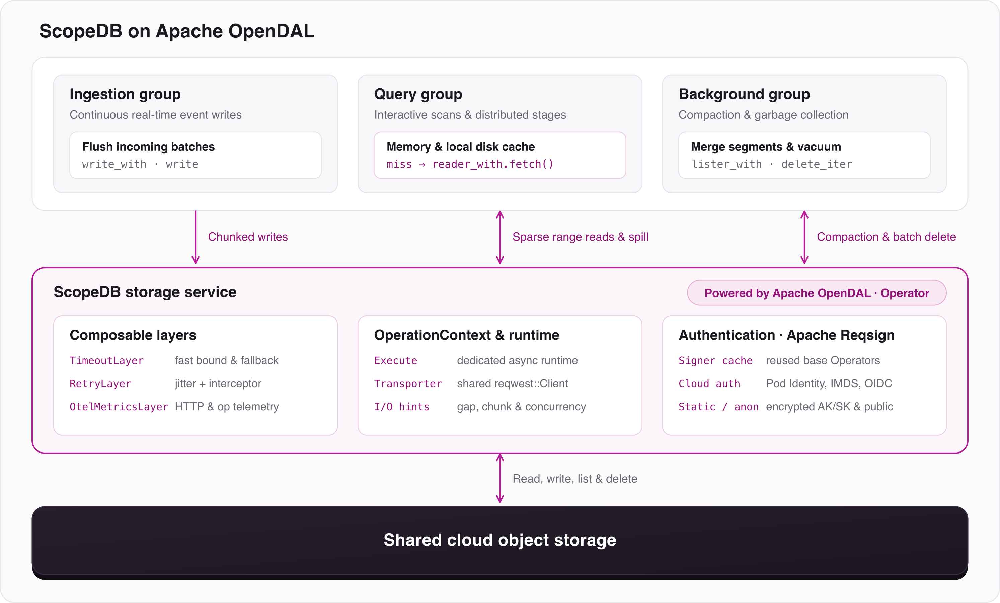

[ScopeDB](https://www.scopedb.io/) is a columnar database built in Rust on cloud object storage for petabyte-scale event analytics, retaining over 10 PB of data in production across operational logs, product events, and AI agent traces. ScopeDB has used [Apache OpenDAL](https://opendal.apache.org/) since our very first version in 2024. Today, we want to share why we chose OpenDAL from day one, how we use its interfaces and layers in practice, and what we have learned running analytical I/O across cloud object stores.

In an object-storage-first database, query latency is primarily driven by columnar projection, index pruning, and multi-tier local caching, while elastic scaling comes from separating stateless compute nodes from durable data. Even so, the database is constantly reading from and writing to object storage. Queries fall back to primary storage on cache misses, while ingestion, background compaction, distributed stage exchange, and data cleanup hit object storage directly. Rather than wrestling with verbose cloud vendor SDKs in Rust, ScopeDB uses Apache OpenDAL as a clean, reliable layer for primary storage access.

<!--truncate-->

## Where Object Storage Sits in ScopeDB's Architecture

ScopeDB separates stateless Rust compute nodes from durable table data stored in shared object storage such as Amazon S3 and S3-compatible services. Compute nodes run in isolated resource groups for continuous event ingestion, interactive and analytical queries, and background tasks such as compaction and garbage collection. All of these resource groups operate over the same committed tables without owning local durable shards. Query nodes maintain memory and local disk caches to serve hot reads quickly, while object storage serves as the primary durable store underneath.



Across these resource groups, primary storage traffic falls into four distinct patterns:

- **Sparse range reads on cache misses**: After column projection, index pruning, and local cache lookups filter out unneeded I/O, query workers fetch only the remaining non-contiguous byte ranges from columnar data files.
- **High-throughput writes and compaction**: Ingestion nodes flush incoming batches and background workers merge smaller segments into larger, clustered files, using concurrent multipart uploads (or single-part puts on restricted endpoints).
- **Distributed stage exchange**: Multi-stage queries spill and shuffle intermediate data across stateless workers through shared storage prefixes and delete those temporary objects asynchronously once execution finishes.
- **Garbage collection (vacuum)**: Background tasks recursively list storage prefixes and delete obsolete or expired objects in batches.

Building and maintaining all four paths directly on top of official cloud Rust SDKs quickly becomes painful. Heavy dependency trees, deeply nested request builders, intricate credential setup, and subtle behavioral differences across S3-compatible vendors force database engineers to spend too much time on storage plumbing. Wrapping [`opendal::Operator`](https://docs.rs/opendal-core/0.59.4/opendal_core/struct.Operator.html) inside a thin storage service allowed us to unify HTTP transport sharing, runtime isolation, authentication, retries, timeouts, and metrics within a few hundred lines of Rust.

## What Works Well in Practice

### 1. Expressive I/O Semantics and Runtime Isolation

Analytical queries rarely need an entire object when falling back to primary storage. Once ScopeDB narrows a scan down to specific columns and pruned segments, and skips blocks already present in the local cache, it is left with a list of byte ranges (`Vec<Range<u64>>`) within an object. Sending one HTTP `GET` per small range wastes round-trips, while fetching the whole object wastes bandwidth.

OpenDAL's [`Reader::fetch`](https://docs.rs/opendal-core/0.59.4/opendal_core/struct.Reader.html#method.fetch) API fits this access pattern directly. By setting `gap`, `chunk`, and `concurrent` on `reader_with`, ScopeDB delegates adjacent-range merging and parallel chunk fetching to OpenDAL instead of maintaining a custom HTTP range state machine:

```rust
let reader = op
    .reader_with(&path)
    .gap(hint.read_gap_size)
    .chunk(hint.read_chunk_size)
    .concurrent(hint.op_concurrency)
    .await?;

let buffers: Vec<opendal::Buffer> = reader.fetch(ranges).await?;
```

Interactive queries and background compaction have different latency and throughput targets, so ScopeDB passes workload-specific tuning hints into the same storage wrapper. Foreground queries fetch smaller chunks to keep latency predictable, whereas compaction reads and multipart writes use larger chunks for throughput, falling back to single-part uploads on S3-compatible endpoints without multipart support. Background vacuum and stage cleanup follow the same pattern, pairing recursive prefix listing with batched deletes.

At the runtime level, CPU-intensive vectorized execution must not starve network I/O polling. ScopeDB dispatches top-level storage calls onto a dedicated async runtime for storage I/O, and also wires that runtime into OpenDAL's [operation context](https://docs.rs/opendal-core/0.59.4/opendal_core/struct.OperationContext.html) alongside a shared [HTTP transport](https://docs.rs/opendal-http-transport-reqwest/0.59.4/opendal_http_transport_reqwest/struct.ReqwestTransport.html). Because OpenDAL's custom executor only schedules internal background tasks when chunk concurrency is greater than one, pairing outer task dispatch with context injection keeps both single-request calls and concurrent chunk tasks on the isolated I/O pool while reusing a single process-wide HTTP client:

```rust
impl opendal::Execute for &'static IoRuntime {
    fn execute(&self, f: opendal::raw::BoxedStaticFuture<()>) {
        self.spawn(f).into_background();
    }
}

let context = OperationContext::from_parts(
    HttpTransporter::new(ReqwestTransport::new(shared_http_client)),
    Executor::with(io_runtime()),
);
let op = op.with_context(context);
```

### 2. Cloud Authentication: From Static Keys to Pod Identity

Authentication often looks simple in early prototypes and grows complicated in cloud deployments. Initially, ScopeDB accessed object storage explicitly with encrypted `access_key_id` and `secret_access_key` pairs in metadata. As we deployed across cloud environments, avoiding the storage and encryption overhead of managing static keys led us to adopt cloud-native authentication, including Kubernetes Pod Identity (such as AWS EKS Pod Identity and IRSA), instance metadata services (`IMDS`), OIDC token chains, and anonymous access for public datasets.

Because OpenDAL handles credential loading and request signing through [Apache Reqsign](https://reqsign.apache.org/), supporting these authentication methods required very little code in ScopeDB. Once we made static keys optional in our S3 builder setup, OpenDAL's default credential chain picked up and refreshed ambient cloud credentials automatically, without pulling vendor IAM SDKs into our upper layers:

```rust
let mut builder = opendal::services::S3::default()
    .bucket(&config.bucket)
    .region(&config.region)
    .root(&config.prefix)
    .endpoint(&config.endpoint);

if let Some(ak) = &config.access_key_id {
    builder = builder.access_key_id(ak);
}
if let Some(sk) = &config.secret_access_key {
    builder = builder.secret_access_key(sk);
}
if config.allow_anonymous {
    builder = builder.skip_signature();
}
```

One practical detail we ran into involves how temporary credentials interact with operator lifecycles. OpenDAL caches temporary credentials on the operator's internal signer. Because ScopeDB builds short-lived storage service handles per task or table operation, constructing a brand-new `Operator` each time would drop that signer cache and repeatedly query metadata or token endpoints. Caching base `Operator` instances by storage configuration in a shared factory preserved OpenDAL's signer cache across short-lived handles.

### 3. Composable Layers Without Reinventing Middleware

Different storage operations have different failure and latency budgets. An interactive query fetching a few megabytes on a cache miss should not stall behind a slow connection, whereas a background compaction upload or batch delete can afford longer backoff retries to ensure completion.

Rather than writing custom retry loops, timeout wrappers, and metrics hooks around each storage call, ScopeDB uses OpenDAL's composable [`Layer`](https://docs.rs/opendal-core/0.59.4/opendal_core/raw/trait.Layer.html) stack. Cloning a cached base `Operator` (already equipped with [`OtelMetricsLayer`](https://docs.rs/opendal-layer-otelmetrics/0.59.4/opendal_layer_otelmetrics/struct.OtelMetricsLayer.html)) is cheap, allowing us to assemble operation-specific operators on demand with [`TimeoutLayer`](https://docs.rs/opendal-layer-timeout/0.59.4/opendal_layer_timeout/struct.TimeoutLayer.html) and [`RetryLayer`](https://docs.rs/opendal-layer-retry/0.59.4/opendal_layer_retry/struct.RetryLayer.html):

```rust
// Latency-sensitive read path: bound stalls aggressively, then fall back to a retrying operator
let fast_read_op = base_op.clone().layer(
    TimeoutLayer::new()
        .with_timeout(read_timeout)
        .with_io_timeout(read_timeout),
);

// Write and delete paths: prioritize eventual success with jittered retries and metrics hooks
let write_op = base_op
    .clone()
    .layer(TimeoutLayer::new().with_io_timeout(write_io_timeout))
    .layer(
        RetryLayer::new()
            .with_jitter()
            .with_notify(RetryMetricsObserver::Write),
    );
```

On the foreground read path, ScopeDB first tries a fast-fail operator whose timeout bounds each underlying chunk read (scaled from the fetch byte budget) rather than imposing a single end-to-end deadline across the entire fetch. If any chunk read stalls past that bound, ScopeDB falls back sequentially to the standard retrying read operator so transient slowness does not fail the query. At the same time, implementing [`RetryInterceptor`](https://docs.rs/opendal-layer-retry/0.59.4/opendal_layer_retry/trait.RetryInterceptor.html) alongside `OtelMetricsLayer` exports HTTP request latencies, retry counts, and backoff durations directly to our OpenTelemetry pipeline.

### 4. Taming S3-Compatible Pitfalls Together in Open Source

In production, object storage rarely means only AWS S3 in a single region. Running across different clouds and S3-compatible services exposes many subtle edge cases: non-standard error codes during batch deletes, semantic quirks in recursive directory deletion on parallel file systems backed by object storage, multipart chunking discrepancies, and redundant `HEAD` requests when file sizes are already recorded in table metadata.

A major advantage of Apache OpenDAL is that these provider-specific edge cases are handled and improved once in upstream rather than worked around separately by every user. Along the way, our team has reported production issues and contributed upstream features and fixes back to the community:

- [OpenTelemetry metrics integration](https://github.com/apache/opendal/pull/5524) and [HTTP-level transport metrics](https://github.com/apache/opendal/pull/5800) for observing storage operations and underlying HTTP performance.
- [Broader S3-compatible error code handling](https://github.com/apache/opendal/pull/6651) so batch deletes retry on provider-specific throttling errors.
- [Enforced chunk splitting on writes](https://github.com/apache/opendal/issues/6521) so buffered uploads respect configured multipart chunk sizes.
- [Content-length hints on reads and copies](https://github.com/apache/opendal/pull/7543) to avoid extra metadata round-trips when object sizes are known.
- [Retryable request signing errors](https://github.com/apache/opendal/pull/8476) so transient credential or signing failures can recover automatically.

## Wrapping Up

On the surface, object storage looks like just `GET`, `PUT`, `LIST`, and `DELETE`, until a database relies on it across diverse cloud environments. Since ScopeDB's earliest days, Apache OpenDAL has served as a dependable, ergonomic Rust layer for primary storage access, taking care of range-read scheduling, cloud authentication, resilience layers, and provider compatibility so we can focus on query execution, multi-tier caching, and indexing.

Thanks to the Apache OpenDAL community for building and maintaining the project, and we look forward to continuing our collaboration upstream. To learn more about ScopeDB, visit [scopedb.io](https://www.scopedb.io/) or read our [storage architecture guide](https://www.scopedb.io/docs/guides/storage-architecture). To explore or contribute to OpenDAL, visit the [Apache OpenDAL GitHub repository](https://github.com/apache/opendal).
